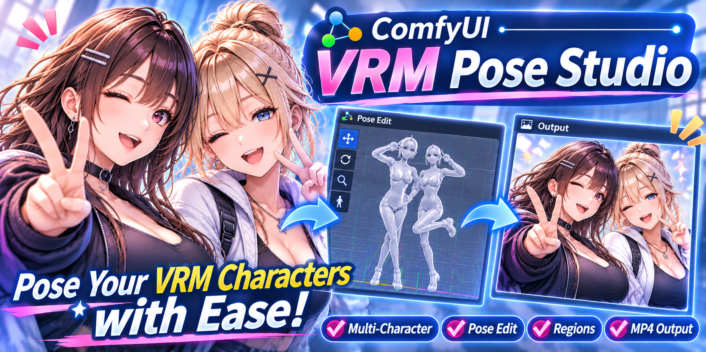
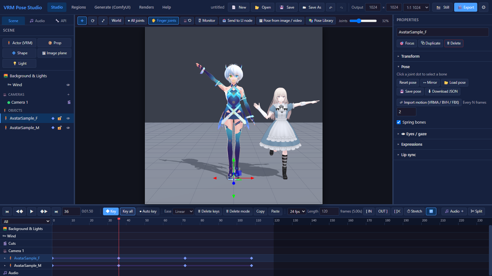
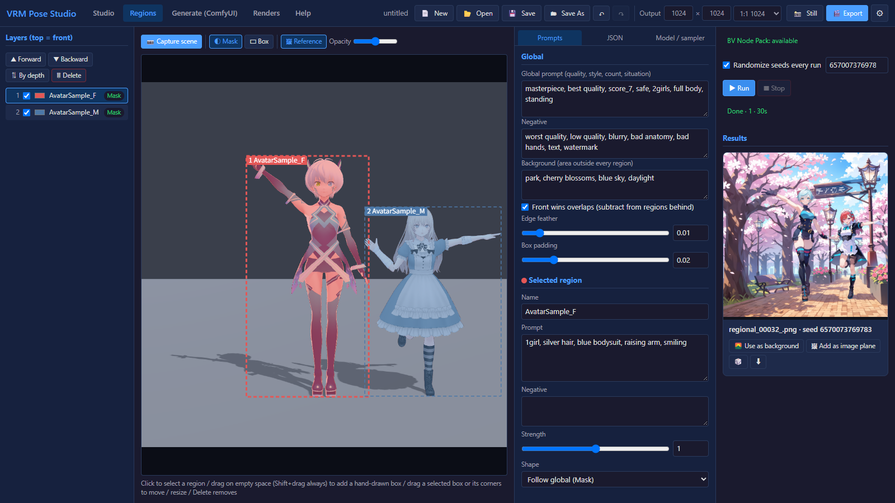
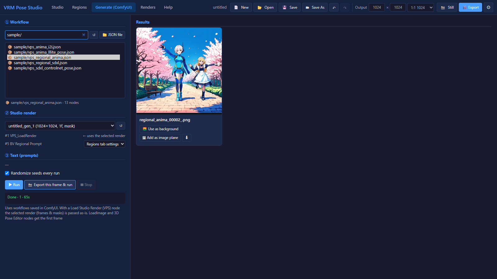

# VRM Pose Studio (ComfyUI custom node + SPA)



**English** | [日本語](README_ja.md)

A full-browser 3D scene / pose / video studio for VRM models, based on [3D Pose Editor (comfyui-vrm-pose-editor)](https://github.com/ketle-man/comfyui-vrm-pose-editor).
It runs as a single-page app on your ComfyUI server (`http://<ComfyUI>/vps`), and the images and videos you export can be passed to your workflows through its nodes.

| Studio | Regions | Generate (ComfyUI) |
|---|---|---|
| [](docs/screenshot_studio.png) | [](docs/screenshot_regions.png) | [](docs/screenshot_generate.png) |
| Pose several VRM models and animate them with keyframes | Generate with a prompt for each character's mask | Pass the render to a workflow (e.g. the bundled samples) and generate |

## Features

| Area | Details |
|---|---|
| Multiple models | Place as many VRM models as you like. Click a joint dot to pick a bone and rotate it with the gizmo (the hips can also move), expression sliders, spring bones (physics), gaze (eyes follow the camera, a scene object or another character's head; "🎯 Place a target" adds a movable target; with no target the eye bones can be rotated by hand), auto blink (interval setting; driven by time so exports blink the same way; timing is offset per character) |
| Pose | Reset / mirror / load and save 3D Pose Editor pose JSON (version 2) / load VRoid Studio .vroidpose |
| Motion | Import VRMA, BVH (SAM3DBody / CMU / Daz) and FBX (Mixamo / MotionBuilder bone names) as keyframes. BVH uses the same options dialog as 3D Pose Editor (hip motion, grounding, smoothing, range); FBX lets you pick the take and whether to keep hip motion |
| Image / video → pose | Estimated with SAM 3D Body (ComfyUI 0.38+ native nodes). An image becomes the selected character's pose, a video becomes motion (keyframes). The toolbar button opens a panel left of the properties so you can compare the source image / video with the model side by side (or overlaid semi-transparently on the viewport). Videos play in sync with the timeline |
| Cameras & cuts | Add any number of cameras, each with its own keyframes. Switch between them on the cut track (playback and export follow the cuts). Select a camera while stopped to edit from its view |
| Monitor | 🖥 Monitor (M) switches to a free view unaffected by keys and cuts. All camera frames are visible and can be picked and moved with the gizmo. The actual camera's view is shown in an inset at the bottom right (stills and exports always use the camera) |
| Depth of field | Per-camera background blur. Focus by distance or by following a character (head) or object. Strength and distance can be keyframed on the camera. Shown live in the viewport (masks are never blurred) |
| Regions | Build a **mask (silhouette)** or a **box (bounding rectangle)** for each character / prop as seen from the shot camera, and give each region its own prompt, negative and strength. Regions are layers, top = front (drag or ▲▼ to reorder, or sort by depth). Overlaps are given to the front region and subtracted from the ones behind (can be turned off). Drag on empty space to add a hand-drawn box. The document is sent as a [BV Node Pack](https://github.com/BlackVortexAI/bv_nodepack) bv.regional v2 document, either to the built-in workflow (Anima + BV Regional Native/Anima Conditioning + [Anima LLLite Regional](https://huggingface.co/Sen-sou/Anima-LLLite-Regional-Controlnet), or a checkpoint) or, from the Generate tab, to any workflow containing a BV Regional Prompt node. img2img from the studio image is also available |
| Generate (ComfyUI) | Run workflows saved in ComfyUI (UI format works too; converted with Workflow Studio's converter). Renders are passed automatically to Load Studio Render / LoadImage / PoseEditor3D nodes; prompts can be edited and seeds randomized. Results can be brought back as a background or an image plane |
| Audio & speech | The "🎵 Audio" panel lists, previews and deletes audio files and adds the checked one as a new audio track at the current time (any number of tracks, each with volume and mute; mixed with ffmpeg on export). Create speech from a line of dialogue (Lemonade 〈Kokoro〉 / VOICEVOX) and use it straight away as an audio track and for lip sync. "🔧 API" sets the engine endpoints and default voices (settings and audio folder are shared with 3D Pose Editor) |
| Pose library | "📚 Pose Library" above the viewport shows saved poses (.json / .vroidpose) and motions (.vrma) as thumbnails; click to apply to the selected character. Filter by folder, name, type and favorites; right-click to apply mirrored, add a memo, rename, delete or rebuild the thumbnail. Also reads 3D Pose Editor's poses/ (with its thumbnails, memos and favorites) |
| Lip sync | The mouth opens with the volume of an audio track (chosen per character). Vowel mouth shapes come from automatic detection in the audio (formant analysis), from the text of the line, or open/close only. Computed from time, so exports match |
| Props | GLB / GLTF, primitives (box, sphere, cylinder, cone, torus, plane, capsule) and image planes. Can be attached to a character's bone (e.g. a hand). Color and opacity can be keyframed |
| Lights | Any number of point, spot and directional lights. Position, direction, color, intensity and spread can be keyframed, and lights can be attached to bones |
| Background | Solid color / image / video (synced to the timeline) / transparent. Floor (normal or shadow only), grid, ambient / key / rim lights, ACES tone mapping |
| Wind | Blow wind on spring bones (hair, clothes). Direction, elevation, strength and gusts are keyed on the timeline's "Wind" track. Select the upwind sphere in the viewport to turn it with the gizmo; the handle and arrow can be hidden with 👁 in the scene list. Gusts are driven by timeline time, so every export sways the same way |
| Timeline | Keyframes per object, camera and background/lights (color, intensity, direction and exposure are interpolated), auto key, easing (linear / smooth / step), moving, copying and pasting keys (also onto other characters), IN/OUT range, time stretch (⏱ Stretch: target, range and length in frames or %; same math as 3D Pose Editor, overlapping keys are thinned, audio offsets follow), audio tracks (multiple, with waveforms; cannot start before 0 s). Characters expand with ▸ into "Eyes", "Blink" and "Lip sync" sub-tracks with their own keys. Filter view (all / characters / environment / audio), 🗑 delete mode (click or drag over keys to delete) |
| Audio split | "✂ Split" opens a waveform dialog to choose the split point with zoom, preview and frame snapping (the B key splits at the playhead instantly). Split clips can be moved separately on the same row, and lip sync and export only use the trimmed range |
| Still | 📸 previews the current frame and offers "Download PNG", "Mask PNG" (transparent background) or "Export to ComfyUI" (input/vrm_pose_studio/) |
| Comic Creator | When [ComfyUI Comic Creator](https://github.com/ketle-man/comfyui-comic-creator) is set to open its 3D Pose 🎛 Editor in VRM Pose Studio, the studio opens with the selected manga panel shape as a red dashed frame (with the panel name) and the output size locked to the panel (not saved in the project; "Release" restores it). "📤 Send to CC panel" inserts the current frame into that panel. Opened from CC, the background starts transparent and the ground hidden |
| Export (video) | PNG sequence and character / prop masks. Under OUTPUT choose WebM (VP9, with alpha on a transparent background), MP4 (H.264) or GIF (transparent on a transparent background, long side 480 px); WebM / MP4 can include the mixed audio. "Save to ComfyUI output" saves to output/vrm_pose_studio/, otherwise the browser downloads it. "Video only" doesn't keep the PNG sequence. Physics is stepped deterministically at dt = 1/fps |
| Usability | Undo/redo, project save (with thumbnails), drag & drop, shortcuts, resizable panels, Japanese / English UI |
| Output frame | The viewport marks the output size with a frame and also draws the scene outside it under a dark translucent veil, so you can see what is just off-frame. Stills, videos and sent images contain only the inside of the frame |
| Preferences (⚙ top right) | Mouse (view-control button mapping, wheel / Ctrl+right-drag zoom, Alt+left-drag zoom, speeds), stronger anti-aliasing, default model (added automatically on New and at startup), language. Saved in `data/settings.json` |

## Installation

1. Search for "VRM Pose Studio" in ComfyUI-Manager and install it, or run this in `ComfyUI/custom_nodes/`:
   ```
   git clone https://github.com/ketle-man/ComfyUI-VRM-Pose-Studio
   ```
2. Install the nodes and models listed under [Requirements](#requirements) for the features you want to use
3. Video export uses ffmpeg: `pip install imageio-ffmpeg` (into ComfyUI's Python; an ffmpeg on PATH also works)
4. Restart ComfyUI and click the figure icon in the top action bar, or open `http://127.0.0.1:8188/vps`

If 3D Pose Editor is installed in the same `custom_nodes` as `comfyui-vrm-pose-editor`, its `model/` (VRM) and `poses/` (pose JSON, VRMA) also appear in the asset lists.

## Requirements

### Basics

| Item | Details |
|---|---|
| ComfyUI | 0.38 or later (for the native SAM 3D Body nodes used by image / video → pose). Tested with 0.43.0 |
| ffmpeg | Used for video export. `pip install imageio-ffmpeg` (`requirements.txt`) or an ffmpeg on PATH |
| Browser | Chrome / Edge or another browser with WebGL2 |
| VRM models | Not included. Get them from [VRoid Hub](https://hub.vroid.com/) or elsewhere, then drag & drop them into the studio to upload |

### Per feature (only if you use it)

| Feature | Nodes / software | Models (location) |
|---|---|---|
| Image / video → pose | ComfyUI's native SAM 3D Body nodes | `sam_3d_body_dinov3_bf16.safetensors` → `models/detection/` ([Comfy-Org/sam-3d-body](https://huggingface.co/Comfy-Org/sam-3d-body), original: [facebook/sam-3d-body-dinov3](https://huggingface.co/facebook/sam-3d-body-dinov3)) |
| Regions | [BV Node Pack](https://github.com/BlackVortexAI/bv_nodepack) (tested with 1.4.4; its Anima attention method doesn't run on ComfyUI 0.43, so the default is the native method) | Either the Anima or the SDXL models below |
| Anima generation (built into the Regions tab, samples) | ComfyUI core | From [circlestone-labs/Anima](https://huggingface.co/circlestone-labs/Anima): `anima-base-v1.0` → `models/diffusion_models/`, `qwen_3_06b_base` → `models/text_encoders/`, `qwen_image_vae` → `models/vae/` |
| Anima LLLite (pose, regions) | ComfyUI core (`AnimaLLLiteApply`) / BV Node Pack | `anima-lllite-any-test-like-v2` → `models/model_patches/` ([Comfy-Org/Anima-LLLite](https://huggingface.co/Comfy-Org/Anima-LLLite), original: [kohya-ss/Anima-LLLite](https://huggingface.co/kohya-ss/Anima-LLLite)), `anima-lllite-regional-exp-v3` → `models/model_patches/` ([Sen-sou/Anima-LLLite-Regional-Controlnet](https://huggingface.co/Sen-sou/Anima-LLLite-Regional-Controlnet)) |
| SDXL generation (samples) | ComfyUI core | An Illustrious-based checkpoint → `models/checkpoints/`, `CN-anytest4_illustrious2_A` → `models/controlnet/` ([2vXpSwA7/iroiro-lora](https://huggingface.co/2vXpSwA7/iroiro-lora/tree/main/test_controlnet2)) |
| Speech from text | [VOICEVOX](https://voicevox.hiroshiba.jp/) or [Lemonade](https://lemonade-server.ai/) (Kokoro) running on this PC | — |
| Sharing with 3D Pose Editor | [comfyui-vrm-pose-editor](https://github.com/ketle-man/comfyui-vrm-pose-editor) (optional) | — |
| Comic Creator integration | [ComfyUI Comic Creator](https://github.com/ketle-man/comfyui-comic-creator) (optional; select VRM Pose Studio under "3D Pose Editor" in its Settings tab) | — |

- The Anima and Anima LLLite models are under CircleStone Labs' **non-commercial license** ([LICENSE](https://huggingface.co/circlestone-labs/Anima/blob/main/LICENSE.md)). The SAM 3D Body model has its own license (SAM License). Neither is included in this repository; you accept each license when you download the models.
- The model names in the samples (`anima_baseV10.safetensors`, `flanimeIllustriousXL_v20.safetensors`, etc.) are from the author's setup. Pick your own files after loading a sample (the official Anima file is `anima-base-v1.0.safetensors`).
- "Send to LI node" only works when the studio was opened from ComfyUI's top menu.
- When the studio was opened from Comic Creator, the same button reads "Send to CC panel" and sends the image to Comic Creator instead (nothing is uploaded to input/).

## Security

VRM Pose Studio has no login of its own and relies on ComfyUI, which has no authentication either. Anyone who can reach your ComfyUI server can open `/vps` and use its API: upload and delete assets, save and delete projects and renders, and change settings.

- By default ComfyUI only listens on `127.0.0.1`, so only this PC can reach it.
- If you start ComfyUI with `--listen` (LAN or internet), only do so on a trusted network, or put an authenticating reverse proxy / VPN in front of it.
- Speech creation (VOICEVOX / Lemonade) only connects to this PC (`localhost` / `127.0.0.1` / `::1`); other hosts are rejected by the server.

## ComfyUI nodes

| Node | Inputs / outputs |
|---|---|
| **Load Studio Render (VPS)** `VPS_LoadRender` | Pick a render exported from the studio and output `IMAGE` (batch), `MASK` (batch), `fps` and `frame_count`. Start frame, count and every-nth can be set. Has "Open Studio" and "Refresh renders" buttons |
| **Send Image to Studio (VPS)** `VPS_SendToStudio` | Save an image from the workflow as a studio background (`backgrounds`) or prop asset (`props`, MASK becomes alpha) |

Renders are saved to `ComfyUI/input/vrm_pose_studio/<name>/` as `frame_00000.png` … (+ `mask_*.png`, `video.mp4`, `meta.json`), so the standard LoadImage node can use them too.

## Sample workflows

Bundled in `example_workflows/`. They appear at the top of the Generate tab list as `📦 sample/…`: pick a render and press ▶ Run. They can also be opened from ComfyUI's template browser (under custom nodes; the `.jpg` with the same name is the thumbnail). The model names are from the author's setup, so pick your own models (see [Requirements](#requirements) for downloads).

| File | What it does | Needs |
|---|---|---|
| `vps_anima_lllite_pose.json` | Anima + LLLite any-test. Copies the render's pose and framing | Anima, anima-lllite-any-test-like-v2 |
| `vps_anima_i2i.json` | Anima img2img (denoise 0.65). Keeps the render's colors and layout | Anima |
| `vps_sdxl_controlnet_pose.json` | SDXL (Illustrious) + ControlNet anytest to copy the pose | Illustrious-based checkpoint, CN-anytest4_illustrious2 |
| `vps_regional_anima.json` | Regions: BV Regional Prompt + Native Conditioning + LLLite regional; pose from LLLite any-test | BV Node Pack, Anima, anima-lllite-regional-exp-v3 / any-test-like-v2 |
| `vps_regional_sdxl.json` | Regions: BV Regional Prompt + Native Conditioning; pose from ControlNet anytest | BV Node Pack, Illustrious-based checkpoint, CN-anytest4_illustrious2 |

When a regional sample is run from the Generate tab, its BV Regional Prompt node receives the Regions tab settings (per-character masks and prompts). In all samples, VAEEncode only provides a latent of the render's size (denoise 1.0).

## Folder layout

```
ComfyUI-VRM-Pose-Studio/
├─ __init__.py            route registration and node loading (each in its own try/except)
├─ dev_server.py          dev server to check the SPA without ComfyUI (python dev_server.py 8790)
├─ py/
│  ├─ config.py           paths (assets/ data/ input/vrm_pose_studio)
│  ├─ routes.py           /vps, /vps_static, /vps/api/* (assets, projects, renders, settings, sample workflows)
│  └─ nodes/studio_nodes.py
├─ templates/index.html
├─ static/
│  ├─ css/main.css
│  ├─ vendor/             three.js r160 / three-vrm 2.1.0 (same as 3D Pose Editor) + TransformControls + FBXLoader (with fflate / NURBSCurve; all from the three.js r160 examples, MIT). One variable name in three-vrm's MToon spot-light shadow was changed for r160 (vSpotShadowCoord → vSpotLightCoord)
│  └─ js/
│     ├─ app.js           layout, header, shortcuts, drag & drop
│     ├─ engine/          viewport / objects (Actor, Prop) / cameras / environment / timeline / studio / exporter
│     ├─ ui/              outliner / inspector / timeline-ui / assets / export-ui (still, video) / settings / motion / cc-frame (Comic Creator panel frame) / image-pose / generate / regional / comfy-run (shared ComfyUI run helpers) / audio-split / time-stretch / help
│     └─ lib/             copied unchanged from 3D Pose Editor / Workflow Studio (BVH, lip sync, SAM3D, workflow conversion)
├─ web/comfyui/vps_extension.js   action bar button, node buttons, receiver for "Send to LI node"
├─ example_workflows/     sample workflows (shown as 📦 sample/ in the Generate tab and in ComfyUI's templates)
├─ assets/<kind>/         uploads (models, props, backgrounds, poses, audio, motions)
└─ data/                  projects and settings
```

## Shortcuts

W/E/R move / rotate / scale · Q local ⇔ world · K key · Space play · ←→ step frames · F focus · M monitor · B split audio at the playhead · Ctrl+Z / Y · Ctrl+D duplicate · Ctrl+C / V copy and paste keys · Delete remove · Ctrl+S save

## Not yet supported

- Detailed settings for video output nodes (VHS etc.) in the Generate tab, multi-frame LoadImage integration
- Creating speech with ComfyUI TTS nodes, and more

## Acknowledgements

- [ComfyUI](https://github.com/comfyanonymous/ComfyUI) — server, node execution and native nodes such as SAM 3D Body / AnimaLLLiteApply
- [three.js](https://github.com/mrdoob/three.js) (r160, MIT) — rendering. GLTFLoader / FBXLoader / OrbitControls / TransformControls / NURBS / BufferGeometryUtils are bundled in `static/vendor/`
- [@pixiv/three-vrm](https://github.com/pixiv/three-vrm) (2.1.0, MIT) — VRM and VRMA loading. FBX (Mixamo) retargeting is based on three-vrm's `loadMixamoAnimation` example
- [fflate](https://github.com/101arrowz/fflate) (MIT) — decompression used by FBXLoader
- [SAM 3D Body](https://huggingface.co/facebook/sam-3d-body-dinov3) (Meta) — pose estimation from images and videos. No code or weights are included; it is only called through ComfyUI's HTTP API
- [BV Node Pack](https://github.com/BlackVortexAI/bv_nodepack) (BlackVortexAI) — the `bv.regional` document and the regional conditioning nodes
- [Anima](https://huggingface.co/circlestone-labs/Anima) (CircleStone Labs), [Anima-LLLite](https://huggingface.co/kohya-ss/Anima-LLLite) (kohya-ss), [Anima LLLite Regional ControlNet](https://huggingface.co/Sen-sou/Anima-LLLite-Regional-Controlnet) (Sen-sou), [CN-anytest](https://huggingface.co/2vXpSwA7/iroiro-lora) (2vXpSwA7) — models used by the samples and regional generation
- [VOICEVOX](https://voicevox.hiroshiba.jp/), [Lemonade](https://lemonade-server.ai/) (Kokoro) — speech from text
- The models in the screenshots are [VRoid](https://vroid.com/)'s AvatarSample (pixiv) (not included)
- [3D Pose Editor](https://github.com/ketle-man/comfyui-vrm-pose-editor) and [Workflow Studio](https://github.com/ketle-man/ComfyUI-Workflow-Studio) (same author) — code reused for pose handling, BVH, lip sync, SAM3D integration and workflow conversion

## License

MIT
