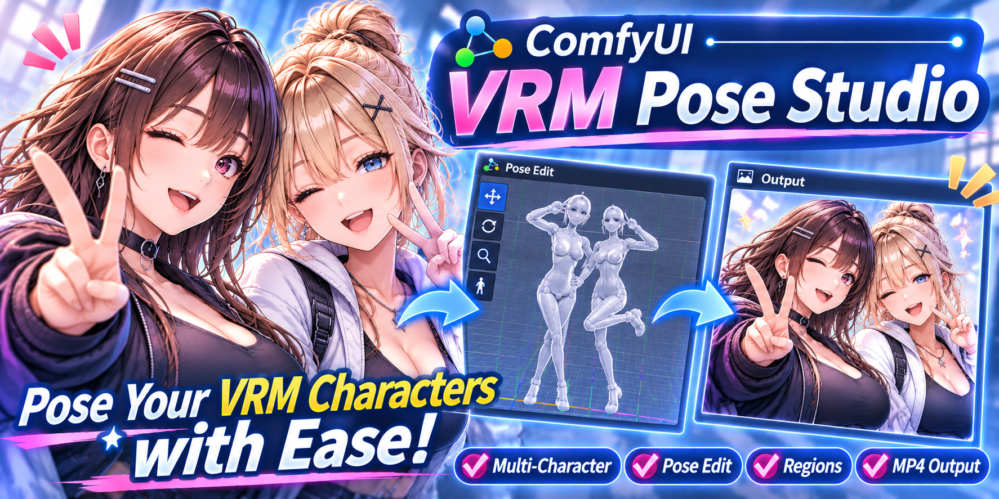
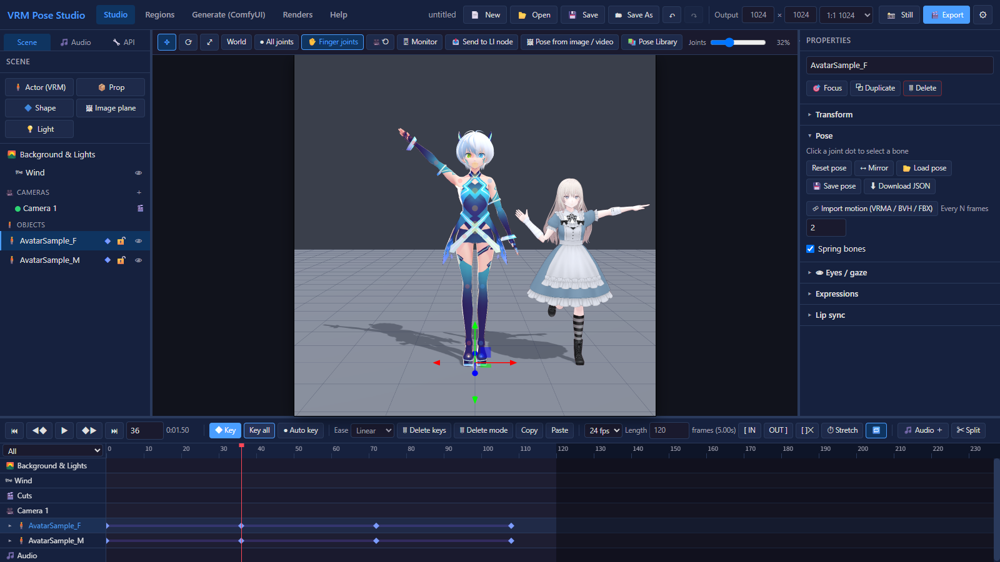
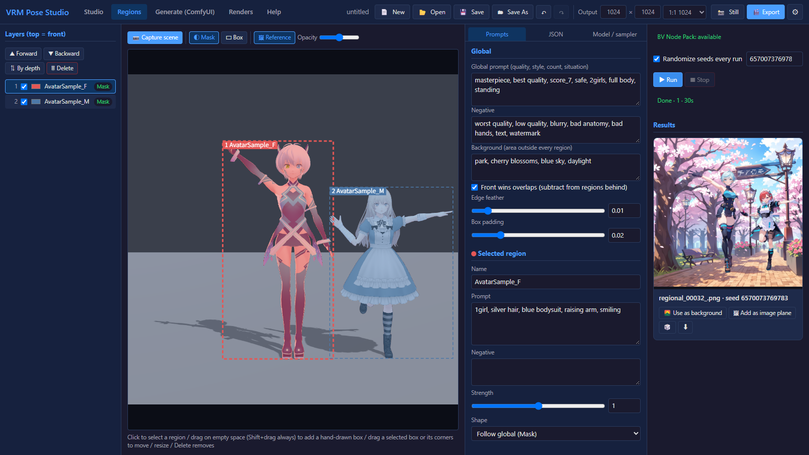
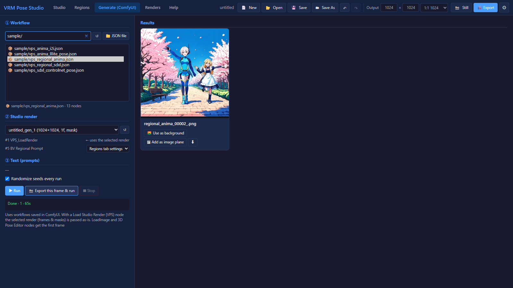

# VRM Pose Studio (ComfyUI custom node + SPA)



[English](README.md) | **日本語**

[3D Pose Editor (comfyui-vrm-pose-editor)](https://github.com/ketle-man/comfyui-vrm-pose-editor) をベースにした、ブラウザ全画面で使う 3D シーン / ポーズ / 動画スタジオです。
ComfyUI のサーバー上で SPA として動き(`http://<ComfyUI>/vps`)、書き出した画像・動画をノードからワークフローへ渡せます。

| スタジオ | リージョン | 生成 (ComfyUI) |
|---|---|---|
| [](docs/screenshot_studio.png) | [](docs/screenshot_regions.png) | [](docs/screenshot_generate.png) |
| 複数の VRM をポーズ付けし、キーフレームで動かす | 人物ごとのマスクにプロンプトを付けて生成 | 書き出しを同梱サンプルなどのワークフローへ渡して生成 |

## 主な機能

| 分類 | 内容 |
|---|---|
| 複数モデル | VRM を何体でも配置。関節(点)クリックでボーン選択、ギズモで回転(腰は移動も可)、表情スライダー、揺れ物(物理)、視線(カメラ・シーンのオブジェクト・人物の頭を目で追う。「🎯 目印を置く」で動かせる目印も置ける。なしのときは目のボーンを手で回せる)、自動まばたき(間隔を指定。時刻から決まるので書き出しでも同じ。人物ごとにタイミングをずらす) |
| ポーズ | リセット / 左右反転 / 3D Pose Editor 形式の pose JSON(version 2)の読込・保存 / VRoid Studio の .vroidpose 読込 |
| モーション | VRMA・BVH(SAM3DBody / CMU / Daz)・FBX(Mixamo / MotionBuilder の骨名)をキーフレームとして取り込み。BVH は 3D Pose Editor と同じ設定ダイアログ(腰の移動・接地・平滑化・範囲)、FBX はテイクの選択と腰の移動の有無 |
| 画像・動画 → ポーズ | SAM 3D Body(ComfyUI 0.38 以降のネイティブノード)で推定。画像は選択中の人物のポーズに、動画はモーション(キーフレーム)に。ビューポート上部のボタンでプロパティの左にパネルが開き、元の画像・動画を横に置いたまま(またはビューポートに半透明で重ねて)モデルと見比べられる。動画はタイムラインと同期して再生 |
| 複数カメラ・カット | カメラを何台でも追加し、それぞれにキーフレーム。カットトラックで切り替え(再生・書き出しはカットに従う)。停止中にカメラを選ぶとその視点で編集 |
| モニター | 🖥 モニター(M)で、キーやカットに左右されない自由視点に切り替え。全カメラの枠が見え、クリックで選んでギズモで動かせる。本番カメラの映りは右下の小窓に表示(静止画・書き出しは常にカメラから) |
| 被写界深度 | カメラごとにピント外をぼかす。ピントは距離指定か、人物(頭)・物を選んで追従。強さ・距離もカメラのキーフレームで動かせる。ビューポートでもそのまま表示(マスクはぼかさない) |
| リージョン | シーンの人物・プロップから、本番カメラで見た**マスク(シルエット)**か**領域(外接矩形)**を作り、リージョンごとにプロンプト・ネガティブ・強さを付けて生成。リージョンはレイヤーで、上ほど手前(ドラッグ・▲▼で並べ替え、奥行き順に自動整列)。重なりは手前を優先して奥から差し引く(オフも可)。空いた所のドラッグで手描きの領域も追加。送信は [BV Node Pack](https://github.com/BlackVortexAI/bv_nodepack) の bv.regional v2 文書で、内蔵ワークフロー(Anima + BV Regional Native/Anima Conditioning + [Anima LLLite Regional](https://huggingface.co/Sen-sou/Anima-LLLite-Regional-Controlnet)、またはチェックポイント)で生成するか、生成タブで BV Regional Prompt ノードを含むワークフローに渡す。スタジオの絵を下絵にした img2img も可 |
| 生成 (ComfyUI) | ComfyUI に保存したワークフロー(UI 形式も可。Workflow Studio の変換を使用)を実行。Load Studio Render / LoadImage / PoseEditor3D ノードへ書き出しを自動で渡し、プロンプト編集・シードのランダム化。結果は背景・画像板として取り込める |
| 音声・音声作成 | 左パネルの「🎵 音声」で音声ファイルを一覧・試聴・削除し、チェックした 1 件を今の時刻から新しい音声トラックとして追加する(音声トラックは何本でも重ねられ、トラックごとに音量・ミュート。書き出しでは ffmpeg で重ねる)。セリフから音声を作成(Lemonade〈Kokoro〉/ VOICEVOX)して、そのまま音声トラックと口パクに使える。「🔧 API」でエンジンの接続先と既定の声を設定(3D Pose Editor と共通の設定・音声フォルダも読む) |
| ポーズライブラリ | ビューポート上部の「📚 ポーズライブラリ」で、保存したポーズ(.json / .vroidpose)とモーション(.vrma)をサムネイルで選んで選択中の人物に当てる。フォルダ・名前・種類・お気に入りで絞り込み、右クリックで左右反転して適用・メモ・名前の変更・削除・サムネイルの作り直し。3D Pose Editor の poses/(サムネイル・メモ・お気に入りも)を読める |
| リップシンク | 音声トラックの音量で口を開閉(人物ごとに使う音声トラックを選べる)。母音(あいうえお)の口形は、音声から自動判定(フォルマント解析)・セリフの文字から・開閉だけ、から選べる。時刻から計算するので書き出しでも同じ結果 |
| プロップ | GLB・GLTF、図形(箱・球・円柱・円錐・トーラス・板・カプセル)、画像板。人物のボーン(手など)へアタッチ可能。色・不透明度もキーフレームで動かせる |
| ライト | 点光源・スポットライト・平行光を何灯でも追加。位置・向き・色・明るさ・広がりをキーフレームで動かせ、人物のボーンにもアタッチ可能 |
| 背景 | 単色 / 画像 / 動画(タイムライン同期)/ 透過。床(通常・影のみ)、グリッド、環境光・キーライト・リムライト、ACES トーンマッピング |
| 風 | 揺れ物(髪・服)に風を当てる。方位・高さ・強さ・そよぎ(ゆらぎ)をタイムラインの「風」トラックのキーで動かせる。ビューポートの風上の球を選んでギズモで向きを変えられ、つまみと矢印はシーン一覧の 👁 で隠せる。ゆらぎはタイムラインの時刻で決まるので書き出しは毎回同じ揺れ方 |
| タイムライン | オブジェクト・カメラ・背景/ライト(色・強さ・向き・露出を補間)ごとのキーフレーム、オートキー、補間(直線・なめらか・ステップ)、キーの移動・コピー&貼り付け(他の人物へも)、IN/OUT 範囲、タイムストレッチ(⏱ 伸縮: 対象・範囲・長さ〈フレーム数か %〉を指定。3D Pose Editor と同じ計算で、重なったキーは間引く。音声の開始位置も合わせる)、音声トラック(複数・波形表示。0 秒より前には置けない)。人物は ▸ で「目」「まばたき」「口パク」の子トラックを開いて別々にキーを打てる。表示の絞り込み(すべて / 人物 / 環境 / 音声)、🗑 削除モード(キーをクリック・なぞって消す) |
| 音声の分割 | 「✂ 分割」で波形のダイアログを開き、拡大・試聴・フレームへの吸着をしながら分割位置を決める(B キーは再生位置ですぐ分割)。分けたクリップは同じ行で別々に動かせ、口パク・書き出しも切った範囲だけを使う |
| 静止画 | 📸 で現在フレームのプレビューを見て、「PNG をダウンロード」「マスク PNG」(背景透過)か「ComfyUI に書き出し」(input/vrm_pose_studio/) |
| 書き出し(動画) | 連番 PNG、人物・プロップのマスク。動画は OUTPUT で WebM(VP9、透明背景ならアルファ付き)・MP4(H.264)・GIF(透明背景なら透過、長辺 480px)を選んで作る(WebM / MP4 は音声合成可)。「Save to ComfyUI output」で output/vrm_pose_studio/ に保存、オフならブラウザでダウンロード。「動画のみ」なら連番 PNG を残さない。物理は dt=1/fps で決定論的に計算 |
| 操作性 | Undo/Redo、プロジェクト保存(サムネイル付き)、ドラッグ&ドロップ、ショートカット、パネル幅の変更、日本語/英語 |
| 操作環境設定(右上 ⚙) | マウス(視点操作のボタン割り当て・ホイール / Ctrl+右ドラッグのズーム・Alt+左ドラッグズーム・各速度)、アンチエイリアス強化、既定モデル(新規作成時・起動時に自動追加)、言語。`data/settings.json` に保存 |

## インストール

1. ComfyUI-Manager で「VRM Pose Studio」を検索してインストール。または `ComfyUI/custom_nodes/` で
   ```
   git clone https://github.com/ketle-man/ComfyUI-VRM-Pose-Studio
   ```
2. 使いたい機能に合わせて、下の「[必要なもの(依存)](#必要なもの依存)」のノードとモデルを入れる
3. 動画書き出しに ffmpeg を使います: `pip install imageio-ffmpeg`(ComfyUI の Python に。PATH 上の ffmpeg でも可)
4. ComfyUI を再起動し、上部アクションバーの人型アイコン、または `http://127.0.0.1:8188/vps` を開く

3D Pose Editor が同じ `custom_nodes` に `comfyui-vrm-pose-editor` として入っていれば、その `model/`(VRM)と `poses/`(pose JSON・VRMA)もアセット一覧に表示されます。

## 必要なもの(依存)

### 基本

| もの | 内容 |
|---|---|
| ComfyUI | 0.38 以降(画像・動画→ポーズのネイティブ SAM 3D Body ノードのため)。0.43.0 で確認 |
| ffmpeg | 動画の書き出しに使用。`pip install imageio-ffmpeg`(`requirements.txt`)か、PATH 上の ffmpeg |
| ブラウザ | WebGL2 が使える Chrome / Edge など |
| VRM モデル | 同梱していません。[VRoid Hub](https://hub.vroid.com/) などから入手し、スタジオにドラッグ&ドロップしてアップロード |

### 機能ごと(使う場合だけ)

| 機能 | ノード / ソフト | モデル(置き場所) |
|---|---|---|
| 画像・動画 → ポーズ | ComfyUI ネイティブの SAM 3D Body ノード | `sam_3d_body_dinov3_bf16.safetensors` → `models/detection/`([Comfy-Org/sam-3d-body](https://huggingface.co/Comfy-Org/sam-3d-body)、元は [facebook/sam-3d-body-dinov3](https://huggingface.co/facebook/sam-3d-body-dinov3)) |
| リージョン | [BV Node Pack](https://github.com/BlackVortexAI/bv_nodepack)(1.4.4 で確認。ComfyUI 0.43 では Anima の attention 方式が動かないため、既定は native 方式) | 下の Anima / SDXL のいずれか |
| Anima で生成(リージョンタブ内蔵・サンプル) | ComfyUI 標準 | [circlestone-labs/Anima](https://huggingface.co/circlestone-labs/Anima) の `anima-base-v1.0` → `models/diffusion_models/`、`qwen_3_06b_base` → `models/text_encoders/`、`qwen_image_vae` → `models/vae/` |
| Anima LLLite(ポーズ・リージョン) | ComfyUI 標準(`AnimaLLLiteApply`)/ BV Node Pack | `anima-lllite-any-test-like-v2` → `models/model_patches/`([Comfy-Org/Anima-LLLite](https://huggingface.co/Comfy-Org/Anima-LLLite)、元は [kohya-ss/Anima-LLLite](https://huggingface.co/kohya-ss/Anima-LLLite))、`anima-lllite-regional-exp-v3` → `models/model_patches/`([Sen-sou/Anima-LLLite-Regional-Controlnet](https://huggingface.co/Sen-sou/Anima-LLLite-Regional-Controlnet)) |
| SDXL で生成(サンプル) | ComfyUI 標準 | Illustrious 系のチェックポイント → `models/checkpoints/`、`CN-anytest4_illustrious2_A` → `models/controlnet/`([2vXpSwA7/iroiro-lora](https://huggingface.co/2vXpSwA7/iroiro-lora/tree/main/test_controlnet2)) |
| セリフから音声を作成 | [VOICEVOX](https://voicevox.hiroshiba.jp/) か [Lemonade](https://lemonade-server.ai/)(Kokoro)をこの PC で起動 | — |
| 3D Pose Editor との共有 | [comfyui-vrm-pose-editor](https://github.com/ketle-man/comfyui-vrm-pose-editor)(任意) | — |

- Anima と Anima LLLite のモデルは CircleStone Labs の**非商用ライセンス**です([LICENSE](https://huggingface.co/circlestone-labs/Anima/blob/main/LICENSE.md))。SAM 3D Body のモデルも独自のライセンス(SAM License)です。どちらもこのリポジトリには含まれず、ダウンロードするときに各ライセンスに同意することになります。
- サンプルのモデル名(`anima_baseV10.safetensors`、`flanimeIllustriousXL_v20.safetensors` など)は作者の環境のものです。読み込んだら手元のファイルに選び直してください(公式の Anima は `anima-base-v1.0.safetensors`)。
- 「LI ノードへ送る」は、ComfyUI のトップメニューからスタジオを開いたときだけ使えます。

## セキュリティ

VRM Pose Studio には独自のログイン機能がなく、ComfyUI にも認証がありません。ComfyUI のサーバーに届く人なら誰でも `/vps` を開いて、その API(アセットのアップロード・削除、プロジェクトと書き出しの保存・削除、設定の変更)を使えます。

- ComfyUI は既定では `127.0.0.1` だけで待ち受けるので、届くのはこの PC だけです。
- `--listen` を付けて LAN やインターネットに公開する場合は、信頼できるネットワークの中だけで使うか、認証付きのリバースプロキシや VPN を前に置いてください。
- セリフからの音声作成(VOICEVOX / Lemonade)の接続先は、この PC(`localhost` / `127.0.0.1` / `::1`)だけです。それ以外の接続先はサーバー側で拒否します。

## ComfyUI ノード

| ノード | 入出力 |
|---|---|
| **Load Studio Render (VPS)** `VPS_LoadRender` | スタジオで書き出したレンダーを選び、`IMAGE`(バッチ)・`MASK`(バッチ)・`fps`・`frame_count` を出力。開始フレーム・枚数・間引き指定可。「Open Studio」「Refresh renders」ボタン付き |
| **Send Image to Studio (VPS)** `VPS_SendToStudio` | ワークフローの画像をスタジオの背景(`backgrounds`)またはプロップ素材(`props`、MASK をアルファに)として保存 |

書き出しは `ComfyUI/input/vrm_pose_studio/<名前>/` に `frame_00000.png` …(+ `mask_*.png`, `video.mp4`, `meta.json`)として保存されるので、標準の LoadImage からも使えます。

## サンプルワークフロー

`example_workflows/` に同梱しています。生成タブの一覧の先頭に `📦 sample/…` として出るので、書き出しを選んで ▶ 実行するだけで使えます。ComfyUI のテンプレート一覧(カスタムノードの項目)からも開けます(同名の .jpg がサムネイル)。モデル名は作者の環境のものなので、手元のモデルに選び直してください(入手先は「[必要なもの(依存)](#必要なもの依存)」)。

| ファイル | 内容 | 必要なもの |
|---|---|---|
| `vps_anima_lllite_pose.json` | Anima + LLLite any-test。書き出しのポーズ・構図を写して生成 | Anima、anima-lllite-any-test-like-v2 |
| `vps_anima_i2i.json` | Anima の i2i(denoise 0.65)。書き出しの色・配置を残す | Anima |
| `vps_sdxl_controlnet_pose.json` | SDXL(Illustrious)+ ControlNet anytest でポーズを写す | Illustrious 系チェックポイント、CN-anytest4_illustrious2 |
| `vps_regional_anima.json` | リージョン: BV Regional Prompt + Native Conditioning + LLLite regional、ポーズは LLLite any-test | BV Node Pack、Anima、anima-lllite-regional-exp-v3 / any-test-like-v2 |
| `vps_regional_sdxl.json` | リージョン: BV Regional Prompt + Native Conditioning、ポーズは ControlNet anytest | BV Node Pack、Illustrious 系、CN-anytest4_illustrious2 |

リージョンのサンプルは、生成タブから実行すると BV Regional Prompt にリージョンタブの設定(人物ごとのマスクとプロンプト)が入ります。いずれも VAEEncode は書き出しと同じサイズの latent を作るためだけに使っています(denoise 1.0)。

## フォルダ構成

```
ComfyUI-VRM-Pose-Studio/
├─ __init__.py            ルート登録とノード読込(個別に try/except)
├─ dev_server.py          ComfyUI 無しで SPA を確認する開発用サーバー(python dev_server.py 8790)
├─ py/
│  ├─ config.py           パス設定(assets/ data/ input/vrm_pose_studio)
│  ├─ routes.py           /vps, /vps_static, /vps/api/*(アセット・プロジェクト・レンダー・設定)
│  └─ nodes/studio_nodes.py
├─ templates/index.html
├─ static/
│  ├─ css/main.css
│  ├─ vendor/             three.js r160 / three-vrm 2.1.0(3D Pose Editor と同じ)+ TransformControls + FBXLoader(fflate / NURBSCurve を含む。いずれも three.js r160 の examples、MIT)。three-vrm は MToon のスポットライト影の変数名を r160 用に 1 箇所修正(vSpotShadowCoord → vSpotLightCoord)
│  └─ js/
│     ├─ app.js           レイアウト・ヘッダー・ショートカット・D&D
│     ├─ engine/          viewport / objects(Actor・Prop)/ cameras / environment / timeline / studio / exporter
│     ├─ ui/              outliner / inspector / timeline-ui / assets / export-ui(静止画・動画)/ settings / motion / image-pose / generate / regional(リージョン)/ comfy-run(ComfyUI 実行の共通処理)/ audio-split(波形で分割)/ time-stretch / help
│     └─ lib/             3D Pose Editor / Workflow Studio から無変更でコピー(BVH・リップシンク・SAM3D・ワークフロー変換)
├─ web/comfyui/vps_extension.js   アクションバーのボタン・ノードのボタン・LI ノードへ送る受け口
├─ example_workflows/     サンプルワークフロー(生成タブに 📦 sample/ として表示・ComfyUI のテンプレートにも出る)
├─ assets/<kind>/         アップロード先(models, props, backgrounds, poses, audio, motions)
└─ data/                  プロジェクト・設定
```

## ショートカット

W/E/R 移動・回転・拡縮 / Q ローカル⇔ワールド / K キー / Space 再生 / ←→ コマ送り / F 注視 / M モニター / B 再生位置で音声を分割 / Ctrl+Z・Y / Ctrl+D 複製 / Ctrl+C・V キーのコピー・貼り付け / Delete 削除 / Ctrl+S 保存

## 未対応(今後の候補)

- 生成タブでの動画出力ノード(VHS 等)の細かい設定、複数フレームの LoadImage 連携
- ComfyUI の TTS ノードでの音声作成 など

## Acknowledgements

- [ComfyUI](https://github.com/comfyanonymous/ComfyUI) — サーバー・ノード実行・SAM 3D Body / AnimaLLLiteApply などのネイティブノード
- [three.js](https://github.com/mrdoob/three.js)(r160、MIT)— 描画。GLTFLoader / FBXLoader / OrbitControls / TransformControls / NURBS / BufferGeometryUtils を `static/vendor/` に同梱
- [@pixiv/three-vrm](https://github.com/pixiv/three-vrm)(2.1.0、MIT)— VRM と VRMA の読込。FBX(Mixamo)のリターゲットは three-vrm の `loadMixamoAnimation` の例を元にしています
- [fflate](https://github.com/101arrowz/fflate)(MIT)— FBXLoader が使う圧縮展開
- [SAM 3D Body](https://huggingface.co/facebook/sam-3d-body-dinov3)(Meta)— 画像・動画からのポーズ推定。コードと重みは同梱せず、ComfyUI の HTTP API 経由で呼び出すだけです
- [BV Node Pack](https://github.com/BlackVortexAI/bv_nodepack)(BlackVortexAI)— リージョンの `bv.regional` 文書と条件づけノード
- [Anima](https://huggingface.co/circlestone-labs/Anima)(CircleStone Labs)、[Anima-LLLite](https://huggingface.co/kohya-ss/Anima-LLLite)(kohya-ss)、[Anima LLLite Regional ControlNet](https://huggingface.co/Sen-sou/Anima-LLLite-Regional-Controlnet)(Sen-sou)、[CN-anytest](https://huggingface.co/2vXpSwA7/iroiro-lora)(2vXpSwA7)— サンプルとリージョン生成で使うモデル
- [VOICEVOX](https://voicevox.hiroshiba.jp/)、[Lemonade](https://lemonade-server.ai/)(Kokoro)— セリフからの音声作成
- スクリーンショットのモデルは [VRoid](https://vroid.com/) の AvatarSample(pixiv)です(同梱していません)
- [3D Pose Editor](https://github.com/ketle-man/comfyui-vrm-pose-editor)・[Workflow Studio](https://github.com/ketle-man/ComfyUI-Workflow-Studio)(同じ作者)— ポーズ処理・BVH・リップシンク・SAM3D 連携・ワークフロー変換のコードを流用

## License

MIT
